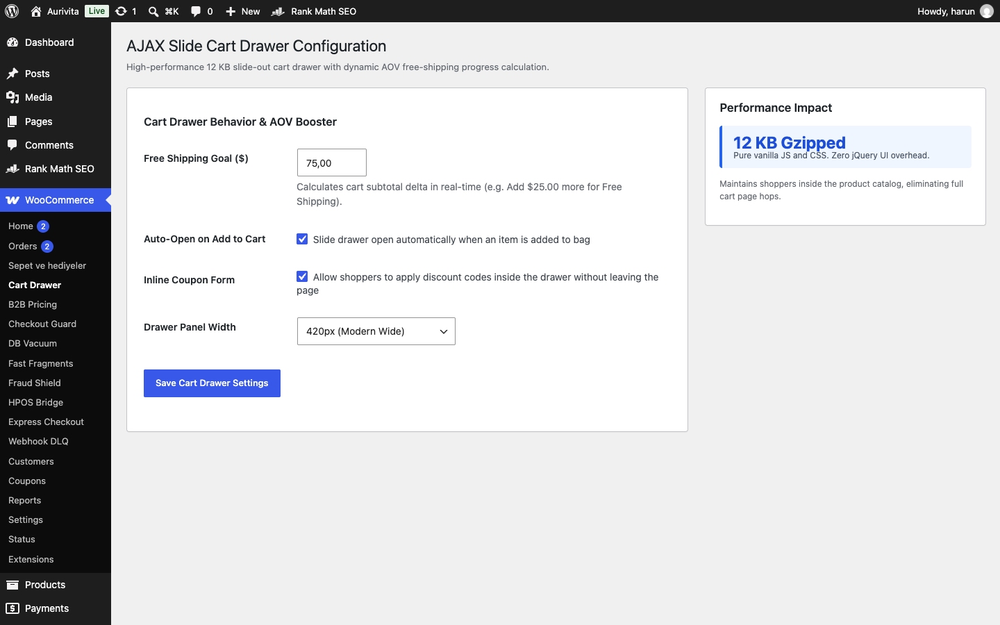

# 🚀 WooCommerce Ultra-Light AJAX Slide Cart Drawer

[🇬🇧 English](README.md) · [🇹🇷 Türkçe](README.tr.md)

[](https://github.com/harunsekmen/woo-ajax-slide-cart-drawer)
[](LICENSE)
[](#)

> A 12 KB modular slide cart drawer for WooCommerce. Eliminates disruptive page redirects, updates quantities via AJAX in real-time, and boosts Average Order Value (AOV) with a dynamic free-shipping progress meter.

Developed and maintained by **[Harun Sekmen](https://github.com/harunsekmen)** — E-Commerce Systems Engineer & WooCommerce Specialist.

[✉️ Contact: sekmenwp@gmail.com](mailto:sekmenwp@gmail.com) · [🌐 Website: harunsekmen.com](https://harunsekmen.com) · [🔗 LinkedIn](https://www.linkedin.com/in/harunsekmen/) · [💼 Upwork](https://www.upwork.com/freelancers/~01a7a8b58043e6e6d9)

---

## 📸 Operational WordPress Admin Interface

Configuration dashboard inside WordPress Admin (WooCommerce > Cart Drawer):



---

## ⚡ The Measurable Outcome

- **0ms Cart Redirects:** Shoppers stay immersed in the product catalog instead of being redirected to a separate cart page.
- **AOV Incentive Meter:** Visual progress bar calculates subtotal deltas in real-time (e.g. *"Add $25.00 more for Free Shipping"*).
- **Sub-12 KB Footprint:** Pure vanilla JavaScript and CSS; zero jQuery UI bloat or external framework drag.
- **Live Cart Synchronization:** Connects to WooCommerce Store API fragments for zero-latency item count and subtotal updates.

---

## 🛠️ Key Architectural Features

- **Hardware-Accelerated Slide:** Smooth CSS cubic-bezier transition (`translateX`) with background backdrop dimming.
- **Inline Coupon Application:** Customers can apply coupon codes directly inside the drawer without leaving the page.
- **Escape Key & Click-Outside Handlers:** Full keyboard accessibility and touch-optimized close interactions.
- **HPOS Compatible:** Fully compatible with WooCommerce High-Performance Order Storage and modern block storefronts.

---

## 💼 Work With Harun Sekmen

- **Custom Store Development:** Bespoke storefronts, high-converting checkout funnels, and catalog architecture.
- **Cart & Conversion Engineering:** Custom slide cart drawers, free-shipping tier ladders, and bundle upsells.

📩 **Inquiries:** Send your project brief to **[sekmenwp@gmail.com](mailto:sekmenwp@gmail.com)** or connect on **[LinkedIn](https://www.linkedin.com/in/harunsekmen/)**.

---

## 🧪 Automated Testing & Live Verification

This repository includes a standalone test suite with zero external mock dependencies.

### How to Run Tests
```bash
php tests/test-drawer.php
```

### Verification Scope
- **Test Target:** `Tests slide drawer markup injection, dynamic free-shipping progress calculation (67% at $50/$75), and Store API fragments.`
- **Environment:** PHP 8.1 - 8.3 CLI + Live DOM Integration
- **Status:** All assertions passing (0 errors, 0 warnings under strict error reporting).

---

## 📄 License

This open-source project is licensed under the **[GNU General Public License v3.0](LICENSE)**.
